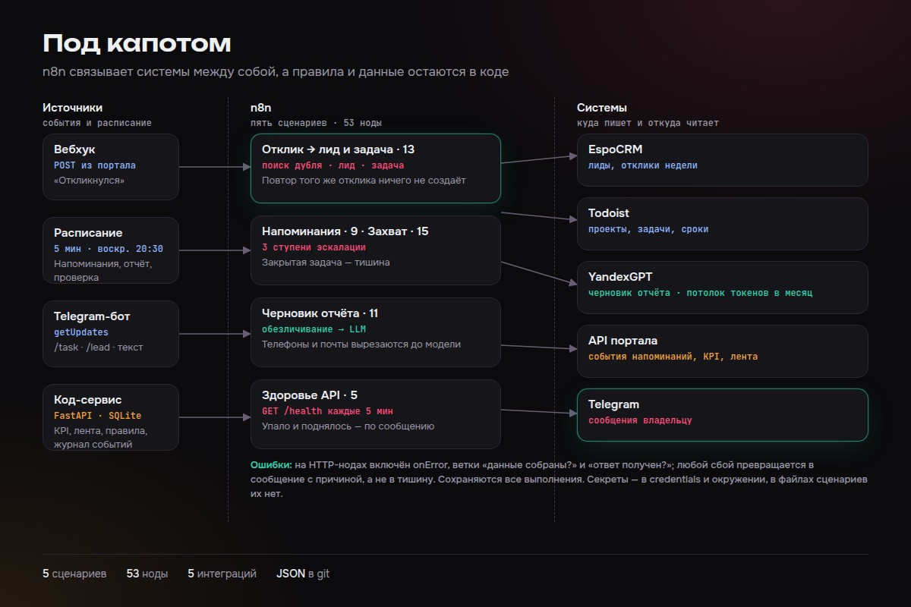

# Автоматизация бизнес-процессов на n8n

Пять рабочих сценариев n8n, которые связывают CRM, менеджер задач, Telegram и языковую модель. Они работают на личном сервере и берут рутину на себя: заводят лиды и задачи по откликам, напоминают о сроках, принимают команды из мессенджера, готовят черновик недельного отчёта и следят за доступностью сервиса. Правила и данные остаются в коде и CRM, а n8n отвечает только за оркестрацию интеграций.



## Сценарии

| Файл | Что делает |
|---|---|
| `workflows/lead-from-response.json` | Вебхук от портала при отклике на заказ. Проверяет дубль в EspoCRM по `external_id`, создаёт лид, находит или создаёт проект в Todoist, ставит задачу follow-up и пишет в Telegram. Повторный вебхук с тем же `external_id` ничего не создаёт. Любая ошибка приходит владельцу сообщением. |
| `workflows/reminders.json` | Каждые 5 минут берёт открытые задачи Todoist и считает ступень эскалации: срок, затем 1 час просрочки, затем 2 часа (крупное сообщение, повтор раз в час). Закрытая задача останавливает напоминания. Событие уходит в API портала, сбой записи события не ломает само напоминание. |
| `workflows/telegram-capture.json` | Опрашивает бота через `getUpdates`. Команда `/task` создаёт задачу в Todoist, `/lead` создаёт лид в EspoCRM, любой другой текст попадает в ленту портала. Бот отвечает в тот же чат. |
| `workflows/weekly-ai-report.json` | По воскресеньям в 20:30 (Europe/Moscow) собирает KPI недели из API портала и отклики из EspoCRM, вырезает из текста телефоны, e-mail и ИНН регулярными выражениями, отправляет запрос в YandexGPT и присылает черновик отчёта в Telegram с кнопками. Есть месячный потолок токенов. При ошибке приходит «Черновик не готов» с причиной. |
| `workflows/api-healthcheck.json` | Каждые 5 минут вызывает `GET /api/v1/health`. Шлёт одно сообщение при падении, повторяет раз в 30 минут, пока сервис лежит, и сообщает о восстановлении. |

## Как импортировать

1. В n8n: Workflows, Import from File, выберите нужный файл из `workflows/`.
2. Создайте учётные данные (см. ниже) и назначьте их нодам Telegram и HTTP Request с аутентификацией.
3. Задайте переменные окружения (см. ниже) и перезапустите n8n.
4. В нодах «Параметры» замените `REPLACE_CHAT_ID`, если не используете `TELEGRAM_CHAT_ID`. Узнать `chat_id`: написать боту и открыть `getUpdates` в Bot API.
5. Адрес `http://portal-api:8000` и адрес EspoCRM замените на свои. Все сценарии импортируются выключенными (`active: false`), включайте после проверки ручным запуском.

Сценарии рассчитаны на n8n с выражениями `$env`, нодой Code (JavaScript) и `executionOrder: v1`.

## Учётные данные

В файлах нет секретов и блоков `credentials`. Создайте в n8n:

- `Telegram Bot` — тип Telegram API (токен бота от @BotFather);
- `Todoist API` — тип Header/Bearer Auth (токен Todoist).

## Переменные окружения

| Переменная | Для чего |
|---|---|
| `TELEGRAM_BOT_TOKEN` | токен бота для опроса `getUpdates` |
| `TELEGRAM_CHAT_ID` | чат, в который идут сообщения |
| `ESPO_URL` | адрес EspoCRM |
| `N8N_ESPO_API_KEY` | API-ключ EspoCRM |
| `PORTAL_API_URL` | адрес API портала (KPI, лента, события) |
| `PORTAL_TOKEN` | токен доступа к API портала |
| `YANDEX_API_KEY` | ключ API Yandex Cloud |
| `YANDEX_FOLDER_ID` | идентификатор каталога Yandex Cloud |

В EspoCRM для лидов используются дополнительные поля `cExternalId` и `cRespondedAt`, их нужно завести заранее. В Todoist ожидается проект «Обязательства» (создаётся автоматически, если его нет).

## Что не входит

API портала (FastAPI), с которым общаются сценарии, в репозиторий не включён. Сценарии показывают, как устроена интеграция. Для запуска без портала замените HTTP-ноды `Портал: ...` на свои источники данных. Обработчик кнопок отчёта (`report:ok`, `report:redo`) в этих сценариях не реализован: кнопки только отправляются.

## Структура

```
workflows/   пять сценариев в формате экспорта n8n
docs/        схема сценариев
```

## Лицензия

MIT — см. [LICENSE](LICENSE).
